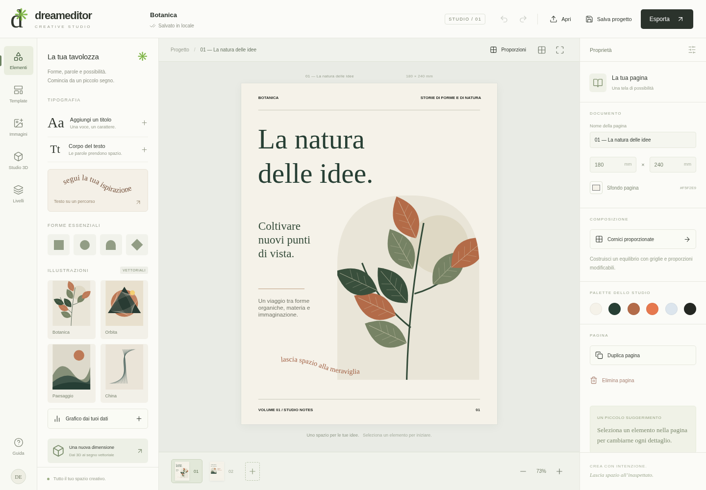

# DreamEditor — Creative Studio

**Scarica il prototipo:** [DreamEditor 0.1 — ZIP pronto da avviare](https://github.com/AntonioStefa/DreamEditor-Omni/raw/refs/heads/main/downloads/v0.1.0/DreamEditor-Prototype-0.1.zip) · [Pagina della release](https://github.com/AntonioStefa/DreamEditor-Omni/releases/tag/v0.1.0)

Il pacchetto contiene l’app compilata, sei esempi, un modello OBJ e gli avviatori. Richiede Node.js 22 o successivo. La [visione originale del progetto](docs/VISIONE_ORIGINALE.md) è conservata nella documentazione.

**Primo prototipo funzionante · 0.1**



[Guarda la galleria dei template](docs/anteprime/templates.png)

Uno studio di composizione visuale per pagine editoriali, illustrazioni e tipografia. Interfaccia italiana, cinque famiglie di template, esempi modificabili e uno studio 3D vettoriale. Funziona senza account, servizi remoti o chiavi API.

## Avviare il pacchetto pronto

1. Estrai completamente `DreamEditor-Prototype-0.1.zip`.
2. Installa **Node.js 22 o successivo** se non è presente sul computer.
3. Su Windows apri `Avvia-Windows.bat`. Su macOS usa `Avvia-Mac.command`; su Linux `Avvia-Linux.sh`. Se il sistema non consente l'avvio del file, apri un terminale nella cartella estratta ed esegui `node start.mjs --open`.
4. Si apre il browser. Se non si apre automaticamente, usa l'indirizzo mostrato dal programma. Lascia aperta la finestra del programma durante il lavoro.

Non servono `npm install` o accesso a Internet per usare il pacchetto già compilato. Non aprire direttamente `dist/index.html`: i moduli JavaScript richiedono il piccolo server incluso. Per fermarlo premi Ctrl+C. Il server ascolta soltanto sul computer locale.

## Prova guidata di cinque minuti

1. Apri **Template** e scegli **Botanica**. Tutti gli elementi delle pagine sono modificabili.
2. Seleziona un titolo e cambia il testo nel pannello **Proprietà**. Puoi trascinare e ridimensionare la cornice.
3. Usa **Immagini** per caricare una foto PNG, JPEG o WebP; scegli la maschera **Organica** nelle proprietà.
4. Aggiungi **Testo su un percorso** e modifica l'ampiezza dell'onda.
5. Apri **Proporzioni** per aggiungere cornici a sezione aurea, tre colonne o una griglia modulare.
6. Apri **Studio 3D**, ruota un esempio o importa `esempi/piramide.obj`, quindi premi **Inserisci nella pagina**.
7. Usa **Salva progetto** per scaricare il file modificabile. **Apri** lo riapre. **Esporta** offre SVG, PNG e Stampa/PDF.

La cartella `esempi` contiene cinque progetti corrispondenti ai template e un sesto esempio **Materia 3D**. Le immagini nella cartella `anteprime` mostrano l'interfaccia verificata nel browser.

## Funzioni disponibili

- Documenti con più pagine, duplicazione e rimozione delle pagine.
- Testo con carattere, dimensione, peso, allineamento e controllo del testo eccedente.
- Titoli su percorso ondulato con curvatura regolabile.
- Forme, illustrazioni originali e immagini con maschere rettangolari, ovali, ad arco, a rombo e organiche.
- Grafici a colonne con dati modificabili.
- Cornici proporzionate: sezione aurea, tre colonne, moduli 2 × 2.
- Livelli, selezione, trascinamento, ridimensionamento, rotazione, opacità, colore e centratura orizzontale.
- Annulla/ripeti fino a 30 modifiche, duplicazione, scorciatoie da tastiera, griglia con aggancio.
- Autosalvataggio locale in IndexedDB e importazione/esportazione JSON validata.
- Studio 3D: esempi nodo/vaso, import OBJ, proiezione ortografica, spigoli o reticolo, conversione in disegno vettoriale.
- SVG e PNG della pagina corrente; stampa/PDF di tutte le pagine tramite browser.

## Conservare il lavoro

Il salvataggio automatico conserva **l'ultimo documento in questo browser e su questo indirizzo**. Aprire un nuovo template sostituisce il documento corrente dopo un avviso. Scarica i file `.dream.json` per conservare più progetti e trasferirli. Cancellare i dati del browser elimina la copia locale. Se il salvataggio locale fallisce, l'app lo segnala: scarica subito il progetto.

L'archivio di esempio non contiene dati personali. Le illustrazioni e i testi dimostrativi sono originali del prototipo. Nessuna foto viene caricata su un server: le immagini sono incorporate nel progetto locale.

## Limiti dichiarati di questa versione

È un prototipo di composizione creativa, non ancora una suite di prestampa.

- Formato fisso 180 × 240 mm. Nessun testo automaticamente concatenato tra pagine o cornici.
- Font locali Georgia, Arial e Courier New: possono essere sostituiti dal sistema. Nessun incorporamento font, sillabazione professionale, LaTeX, giustificazione avanzata o conversione delle lettere in tracciati.
- Ritaglio delle immagini centrato, senza spostamento interno dell'immagine.
- Le cornici proporzionali vengono aggiunte alla pagina; non riordinano automaticamente gli elementi esistenti.
- Il 3D è wireframe: le linee posteriori rimangono visibili. Nessuna ricostruzione artistica da foto, shader pittorico, ombra a china, import GLB/FBX o modifica successiva della camera dopo l'inserimento. Puoi riaprire lo studio e creare una nuova vista.
- PDF tramite stampa browser, senza CMYK, abbondanze o certificazione PDF/X. PNG 1440 × 1920 px (circa 203 ppi al formato della pagina), non un preset 300 dpi.
- Fino a 60 pagine e 300 elementi per pagina. Questi sono limiti di input, non una garanzia di prestazioni massime. Le prove sono state svolte sui documenti campione.
- Immagine importata fino a 12 MB, ridimensionata a un massimo di 2400 px sul lato maggiore; immagini del documento fino a 20 MB di dati incorporati. File progetto fino a 25 MB.
- OBJ fino a 5 MB / 20.000 vertici e facce, risultato massimo 14.000 segmenti. Semplificare i modelli più grandi.
- Verificato su Chromium nell'ambiente di sviluppo. Test su Safari, Firefox, touch e computer reali Windows/macOS rimangono da eseguire.

## Sviluppo dal sorgente

Richiede Node.js 22+, npm e un browser Chromium per i test.

```sh
npm ci
npm run dev
```

Build e verifiche:

```sh
npm run test
npm run build
npm run test:e2e
npm run format:check
```

I test Playwright cercano Chromium in `/usr/bin/chromium` nell'ambiente cloud. Su altri computer imposta `PLAYWRIGHT_CHROMIUM_EXECUTABLE` al percorso del browser, oppure installa il browser gestito con `npx playwright install chromium` (la configurazione lo usa se il browser di sistema non esiste).

Per rigenerare lo ZIP: `npm run package`. Il comando esegue il build e richiede l'utility `zip`. Il server del pacchetto è scritto in JavaScript e non ha dipendenze esterne.

L'architettura e il confronto delle librerie sono in `docs/ARCHITECTURE.md` e `docs/LIBRARIES.md` nel repository, oppure in `documentazione` nel pacchetto. I risultati delle verifiche sono in `docs/VALIDATION.md`.

La release GitHub distribuisce il pacchetto scaricabile e i sorgenti. L’app si avvia localmente: non è un servizio web ospitato.
